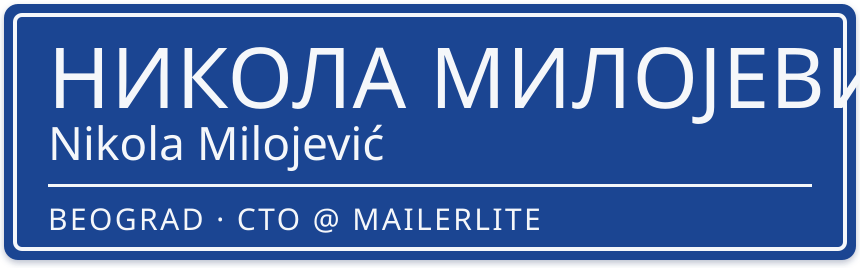
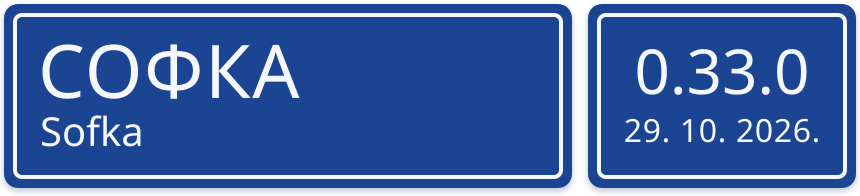
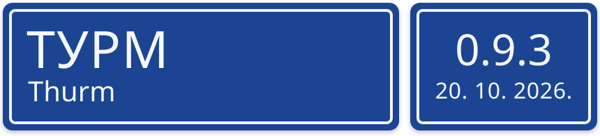

<a href="https://nikola.milojevic.me"><picture>
  <source media="(prefers-color-scheme: dark)" srcset="assets/name-dark.svg">
  
</picture></a>

I'm CTO at [MailerLite](https://www.mailerlite.com). I also build open-source tools for Kubernetes and the terminal.

<a href="https://sofka.rs"><picture>
  <source media="(prefers-color-scheme: dark)" srcset="assets/sofka-dark.svg">
  
</picture></a>

**sofka** is a Kubernetes TUI written in Rust, on kube-rs and ratatui. Flux and Argo CD are built in, bulk actions and port-forwards never block the UI, and `X` tells you why something is broken, from evidence, with no AI. It's named after Sophie, a Russian Blue who watches the screen.

```sh
brew install sofka
```

[sofka.rs](https://sofka.rs) · [Repository](https://github.com/nklmilojevic/sofka) · [Compared with k9s](https://github.com/nklmilojevic/sofka/blob/main/docs/vs-k9s.md)

<br>

<a href="https://github.com/nklmilojevic/thurm"><picture>
  <source media="(prefers-color-scheme: dark)" srcset="assets/thurm-dark.svg">
  
</picture></a>

**thurm** is a native macOS terminal for Apple silicon. Sessions keep running after you quit the app, remote tabs work like local ones, and agent status shows which coding agent is waiting for you.

**[Download Thurm.dmg](https://github.com/nklmilojevic/thurm/releases/latest/download/Thurm.dmg)** · [Documentation](https://docs.thurm.rs) · [Repository](https://github.com/nklmilojevic/thurm)

<br>

[nikola.milojevic.me](https://nikola.milojevic.me) · [X](https://x.com/nklmilojevic) · [All repositories](https://github.com/nklmilojevic?tab=repositories)
